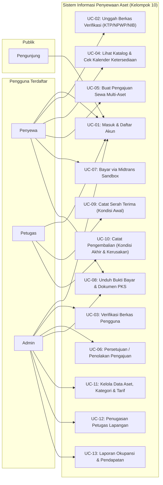
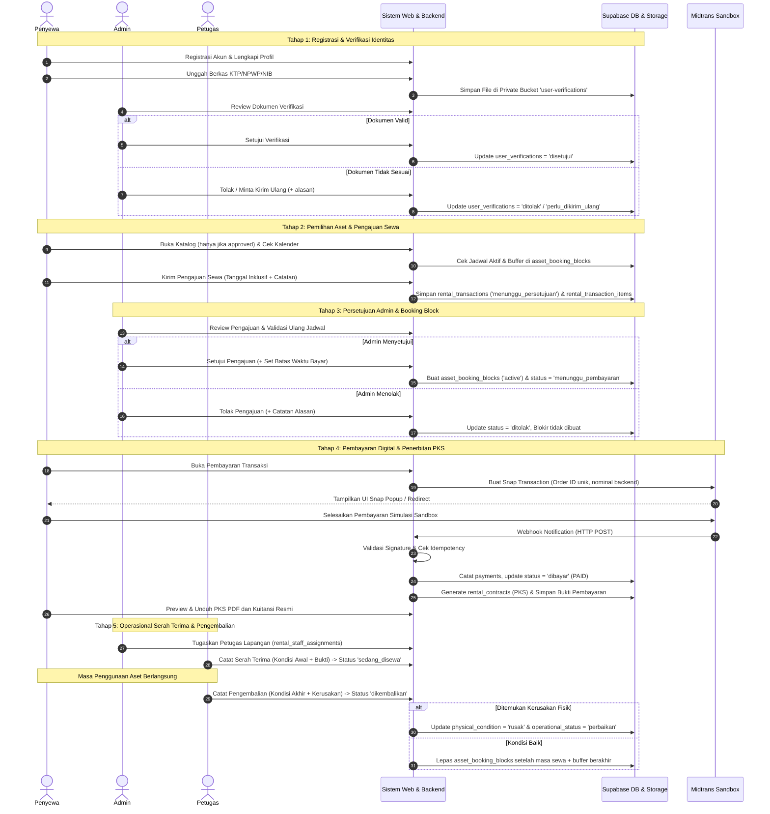

# Analisis Kebutuhan Sistem Informasi Penyewaan Aset
**Proyek:** Sistem Informasi Penyewaan Aset — Kelompok 10  
**Versi:** 2.0 (Diselaraskan dengan PRD Revisi, Dokumen Spesifikasi, dan Skema Database 21 Tabel)  
**Status:** Dokumen Resmi Hasil Analisis Kebutuhan  
**Tanggal:** 18 November 2026  

---

## 1. Identifikasi Masalah

Pengelolaan penyewaan aset fisik seperti tanah, gedung pertemuan, dan ruangan pada satu entitas pengelola (baik instansi pemerintah maupun korporasi swasta) masih sering menghadapi kendala operasional yang signifikan jika dilakukan secara manual atau terfragmentasi:
1. **Risiko Benturan Jadwal (Double Booking):** Kurangnya sistem terpusat yang memblokir hari kalender secara inklusif dan memperhitungkan waktu persiapan (buffer pembersihan, dekorasi, dan pengecekan).
2. **Integritas Calon Penyewa & Keamanan Aset:** Tidak adanya mekanisme verifikasi identitas resmi (KTP, NPWP, NIB) sebelum pengguna dapat menelusuri katalog dan mengajukan penyewaan, menimbulkan risiko penipuan atau penyewa fiktif.
3. **Kalkulasi Biaya yang Tidak Transparan & Rawan Manipulasi:** Perhitungan tarif harian, bulanan, dan tahunan yang tidak terstandardisasi serta pengajuan harga yang tidak terekam historinya secara andal.
4. **Alur Pembayaran yang Tidak Terintegrasi:** Pembayaran manual rentan keterlambatan verifikasi, bukti transfer palsu, dan kesulitan pelacakan status dana masuk secara seketika.
5. **Ketiadaan Legalitas Formal Otomatis:** Perjanjian Kerja Sama (PKS) dan bukti pembayaran resmi sering terlambat dibuat atau tercecer, menyulitkan audit keuangan dan hukum.
6. **Pencatatan Serah Terima dan Pengembalian yang Lemah:** Kerusakan fisik aset pasca-sewa sering kali tidak terdata kondisi awalnya, menyebabkan perselisihan antara pengelola dan penyewa.

---

## 2. Tujuan Sistem

1. **Digitalisasi Terpadu:** Menyediakan platform berbasis web satu pintu untuk mengelola seluruh daur hidup penyewaan aset dari inventarisasi hingga pengembalian.
2. **Pencegahan Benturan Jadwal:** Menjamin alokasi aset berbasis **hari kalender inklusif** dengan buffer persiapan otomatis serta pencegahan konkurensi (exclusion constraint database).
3. **Verifikasi Legalitas Bertingkat:** Memastikan hanya pengguna yang dokumen identitas/legalitasnya telah diverifikasi dan disetujui Admin yang berhak melihat katalog dan mengajukan permohonan sewa.
4. **Otomatisasi Transaksi & Pembayaran:** Mengintegrasikan pembayaran digital via Midtrans Sandbox dengan verifikasi webhook aman, rekonsiliasi otomatis, dan penerbitan bukti bayar resmi.
5. **Penerbitan Dokumen PKS Terotomatisasi:** Menghasilkan dokumen kontrak/Perjanjian Kerja Sama digital yang sah secara otomatis setelah pembayaran terkonfirmasi.
6. **Akuntabilitas Petugas Lapangan:** Memfasilitasi petugas operasional untuk mencatat kondisi fisik aset saat serah terima dan pengembalian (disertai bukti foto dan catatan kerusakan).
7. **Visibilitas dan Audit Trail:** Menyediakan rekam jejak status komprehensif, notifikasi real-time (in-app dan web push), serta laporan pendapatan dan utilisasi aset.

---

## 3. Identifikasi Stakeholder

1. **Dosen Pembimbing / Penguji:** Pemilik standar akademis dan teknis yang menetapkan kriteria keberhasilan proyek akhir rekayasa perangkat lunak.
2. **Pimpinan / Manajemen Pengelola Aset:** Pihak pengambil keputusan yang membutuhkan laporan berkala mengenai okupansi aset, pendapatan sewa, dan status pemeliharaan.
3. **Admin Pengelola Sistem:** Tim staf internal pengelola yang bertugas memverifikasi identitas, menyetujui pengajuan sewa, mengelola inventaris, dan menetapkan tarif.
4. **Petugas Operasional Lapangan:** Personel lapangan yang berinteraksi langsung dengan fisik aset saat serah terima awal dan penerimaan kembali pasca-sewa.
5. **Penyewa (Perorangan / Korporasi / Organisasi):** Pihak eksternal yang memerlukan kepastian ketersediaan aset, transparansi tarif, kemudahan pembayaran, dan perlindungan hukum via PKS.

---

## 4. Identifikasi Aktor dan Peran

Sistem menerapkan **Role-Based Access Control (RBAC)** ketat dengan 3 (tiga) peran aktor pengguna terotentikasi, ditambah peran publik umum:

| Aktor | Deskripsi Peran & Batasan Hak Akses |
|---|---|
| **Publik (Tamu)** | Pengunjung tanpa autentikasi; hanya dapat mengakses Beranda publik, informasi layanan, dan halaman Masuk/Daftar. Tidak dapat melihat katalog aset secara penuh sebelum verifikasi. |
| **Penyewa (Renter)** | Pengguna terdaftar yang telah melengkapi profil dan lolos verifikasi berkas (KTP/NPWP/NIB). Berhak melihat katalog, memeriksa ketersediaan, mengajukan sewa, membayar via Midtrans, mengunduh PKS/bukti bayar, dan melihat riwayat sewa miliknya sendiri. |
| **Petugas (Officer)** | Personel lapangan yang ditugaskan khusus oleh Admin pada transaksi tertentu. Berhak melihat daftar penugasan, memeriksa jadwal, mencatat kondisi awal aset saat serah terima, serta mencatat kondisi akhir, kerusakan, dan catatan pengembalian. Tidak berwenang mengubah tarif atau menyetujui pengajuan. |
| **Admin** | Pengelola utama sistem dengan kewenangan penuh: memverifikasi berkas pengguna, mengelola data pengguna/role, CRUD kategori dan aset, mengunggah foto aset, mengelola tarif (harian/bulanan/tahunan), melihat kalender okupansi, menyetujui/menolak pengajuan sewa, menugaskan petugas, memantau pembayaran & PKS, serta mengatur parameter operasional (buffer & expiry). |

---

## 5. Kebutuhan Fungsional (Functional Requirements)

Berdasarkan PRD v2.0 dan rancangan target sistem, kebutuhan fungsional dikelompokkan ke dalam modul-modul berikut:

### Modul A: Autentikasi dan Profil Pengguna
- **KF-01 (Registrasi & Login):** Sistem menyediakan registrasi akun penyewa (nama, email, telepon, password) dan login dengan session berbasis Supabase Auth.
- **KF-02 (Manajemen Profil):** Pengguna dapat memperbarui informasi kontak, alamat, dan nomor telepon.
- **KF-03 (Proteksi Role Server-Side):** Sistem memvalidasi role pengguna pada setiap route dan API endpoint (Penyewa, Petugas, Admin).

### Modul B: Verifikasi Legalitas Calon Penyewa
- **KF-04 (Unggah Dokumen Verifikasi):** Pengguna wajib mengunggah file identitas (KTP bagi perorangan, NPWP/NIB bagi badan usaha/organisasi) ke private storage Supabase.
- **KF-05 (Review Verifikasi oleh Admin):** Admin dapat memeriksa dokumen via signed URL, kemudian memutuskan status: `disetujui`, `ditolak` (wajib disertai alasan penolakan), atau `perlu_dikirim_ulang`.
- **KF-06 (Gatekeeper Akses Katalog):** Sistem menolak akses katalog dan detail aset jika status verifikasi pengguna belum `disetujui` (diverifikasi ketat di backend).

### Modul C: Manajemen Inventaris Aset dan Tarif
- **KF-07 (CRUD Kategori Aset):** Admin dapat menambah, mengubah, dan menonaktifkan kategori aset (tanah, gedung pertemuan, ruangan).
- **KF-08 (CRUD Data Aset):** Admin dapat mengelola kode aset unik, nama, deskripsi, luas area (`area_size`, `area_unit`), lokasi detail, spesifikasi (JSONB), kondisi fisik (`baik`, `perlu_pemeriksaan`, `rusak`), dan status operasional (`siap`, `perbaikan`, `tidak_tersedia`).
- **KF-09 (Manajemen Galeri Foto Aset):** Admin dapat mengunggah multi-foto ke storage publik (`asset-photos`), mengatur foto utama (`is_primary`), dan urutan tampil (`sort_order`).
- **KF-10 (Manajemen Struktur Tarif Multi-Periode):** Admin dapat menetapkan tarif harian, bulanan, dan tahunan pada `asset_rates` lengkap dengan masa berlaku (`effective_from` s/d `effective_until`).

### Modul D: Kalender, Pencarian, dan Pengajuan Sewa
- **KF-11 (Katalog & Filter):** Penyewa terverifikasi dapat mencari dan menyaring aset berdasarkan kategori, lokasi, kondisi, dan rentang harga.
- **KF-12 (Pemeriksaan Ketersediaan & Kalender):** Sistem menampilkan kalender ketersediaan aset berbasis **hari kalender inklusif** yang memperhitungkan jadwal aktif dan buffer sebelum/sesudah sewa.
- **KF-13 (Kalkulasi Biaya Multi-Aset Backend):** Backend menghitung estimasi biaya secara otomatis berdasarkan snapshot tarif di database; nominal dari input browser tidak dipercaya.
- **KF-14 (Pengajuan Sewa):** Penyewa dapat memilih satu atau beberapa aset, menentukan rentang tanggal, mengisi tujuan sewa dan catatan permohonan. Transaksi tersimpan berstatus `menunggu_persetujuan`.

### Modul E: Persetujuan dan Anti Double-Booking
- **KF-15 (Pemeriksaan Ulang & Review Admin):** Admin memeriksa ketersediaan aset terkini, lalu menyetujui atau menolak pengajuan (wajib alasan jika menolak).
- **KF-16 (Alokasi Booking Block Otomatis):** Saat disetujui, transaksi beralih ke status `menunggu_pembayaran` dan sistem membuat entri `asset_booking_blocks` berstatus `active` yang dilindungi *Exclusion Constraint GiST* untuk mencegah benturan jadwal secara mutlak.
- **KF-17 (Pelepasan Blokir):** Jika pengajuan ditolak, dibatalkan oleh penyewa, atau tenggat pembayaran kedaluwarsa (`payment_due_at`), blok jadwal otomatis diubah menjadi `released` atau `expired`.

### Modul F: Pembayaran Midtrans Sandbox
- **KF-18 (Inisiasi Pembayaran Digital):** Penyewa memulai pembayaran hanya pada transaksi yang telah disetujui Admin. Sistem menerbitkan Snap Token / URL pembayaran Midtrans Sandbox dengan Order ID unik.
- **KF-19 (Webhook Midtrans & Idempotency):** Sistem menerima notifikasi HTTP POST dari Midtrans, memverifikasi *Signature Key*, menerapkan idempotency via `payment_webhook_events`, dan memperbarui status transaksi menjadi `dibayar` (`PAID`).

### Modul G: Dokumen Kontrak PKS & Bukti Pembayaran
- **KF-20 (Penerbitan PKS Otomatis):** Setelah pembayaran terkonfirmasi, sistem secara otomatis menerbitkan dokumen Perjanjian Kerja Sama (PKS) digital dengan nomor kontrak unik dan menyimpannya di private storage.
- **KF-21 (Preview & Unduh PKS / Kuitansi):** Penyewa dan Admin dapat melihat preview, mengunduh PDF, dan mencetak ulang PKS serta bukti kuitansi pembayaran resmi.

### Modul H: Penugasan Petugas, Serah Terima & Pengembalian
- **KF-22 (Penugasan Petugas Lapangan):** Admin menugaskan Petugas tertentu pada transaksi yang telah lunas via `rental_staff_assignments`.
- **KF-23 (Pencatatan Serah Terima):** Petugas mencatat waktu penyerahan, kondisi awal aset, catatan kelengkapan, dan foto bukti di `handover_records`. Status transaksi beralih menjadi `sedang_disewa` (`RENTED`).
- **KF-24 (Pencatatan Pengembalian & Penyesuaian Status Aset):** Petugas mencatat waktu kembali, kondisi akhir, catatan kerusakan, dan foto bukti di `return_records`. Jika aset rusak atau perlu pemeriksaan, sistem otomatis mengubah status operasional aset menjadi `perbaikan` atau `tidak_tersedia`.

### Modul I: Notifikasi dan Riwayat Transaksi
- **KF-25 (Audit Trail / Riwayat Status):** Setiap pergantian status transaksi dicatat di `rental_status_history` mencakup status lama, status baru, aktor pengubah, catatan, dan timestamp.
- **KF-26 (Notifikasi In-App & Web Push):** Notifikasi otomatis dikirimkan saat terjadi event krusial (verifikasi diputuskan, pengajuan disetujui/ditolak, pembayaran berhasil, PKS terbit, dan jadwal serah terima).

---

## 6. Kebutuhan Nonfungsional (Non-Functional Requirements)

| Kategori | Parameter & Spesifikasi |
|---|---|
| **Keamanan (Security)** | - Enkripsi transmisi via HTTPS / TLS. - Supabase Row Level Security (RLS) pada 21 tabel data. - Pemisahan private storage (dokumen KTP/NPWP, PKS, bukti bayar) menggunakan presigned URL berbatas waktu (maks 15 menit). - Proteksi CSRF, sanitasi input dengan Zod schema, dan pembatasan rate limit pada endpoint sensitif. - Tidak mengekspos `SUPABASE_SERVICE_ROLE_KEY` atau `MIDTRANS_SERVER_KEY` ke lingkungan browser/klien. |
| **Integritas Data** | - ACID Transactions pada pembentukan transaksi, booking blocks, dan konfirmasi pembayaran. - Penggunaan tipe data `daterange` dengan ekstensi `btree_gist` untuk exclusion constraint anti-tabrakan jadwal kalender. - Idempotency key pada pemrosesan webhook pembayaran untuk mencegah double processing. |
| **Kinerja & Responsivitas** | - Rendering cepat dengan Next.js App Router (Server Components & Server Actions/Route Handlers). - Waktu respons query katalog dan kalender < 1 detik. - Responsif terhadap layar Desktop (min 1280px), Tablet (768px - 1024px), dan Mobile (360px - 480px). |
| **Aksesibilitas & UI/UX** | - Mematuhi panduan kontras warna WCAG AA (rasio kontras minimal 4.5:1 untuk teks biasa). - Menampilkan label teks jelas pada setiap status badge, tidak mengandalkan warna semata. - Menyediakan visual feedback komprehensif: Loading skeleton, Empty state, Error alerts, dan Success toast. |
| **Ketersediaan & Reliabilitas** | - Kegagalan pada antrean Web Push Notification tidak boleh menggugurkan atau membatalkan transaksi inti bisnis. - Data tersimpan secara persisten di cloud PostgreSQL Supabase, tidak hilang saat refresh atau relogin. |

---

## 7. Diagram Use Case & Aktor

---

## 8. Alur Proses Bisnis Utama (Business Process Flow)

---

## 9. Aturan Bisnis Kritis (Core Business Rules)

1. **Sistem Satu Entitas Pengelola:** Sistem bukan marketplace banyak pemilik. Semua aset adalah milik entitas penyelenggara tunggal. Tidak ada role "Owner".
2. **Kategori Domain Aset:** Dibatasi secara ketat pada ranah tanah, gedung pertemuan, dan ruangan.
3. **Penyewaan Berbasis Hari Kalender Inklusif:**
   - Dihitung per hari penuh (bukan jam).
   - Penggunaan aset meskipun hanya 2–3 jam tetap memblokir 1 hari kalender penuh (00:00 hingga 23:59).
   - Tanggal mulai dan tanggal selesai bersifat inklusif (contoh: 10 Nov s/d 12 Nov dihitung 3 hari).
4. **Buffer Persiapan Otomatis:**
   - Sistem memperhitungkan buffer persiapan sebelum (`preparation_before_days`) dan sesudah sewa (`preparation_after_days`) yang nilainya diambil dinamis dari tabel `rental_settings`.
5. **Anti Double-Booking Terjamin:**
   - Ketersediaan diverifikasi dua kali: saat formulir dibuka dan saat Admin menyetujui.
   - Pengecekan overlap menggunakan PostgreSQL Exclusion Constraint GiST pada rentang tanggal `daterange` terhadap entri yang berstatus `active`.
6. **Katalog Terlindungi:**
   - Pengguna belum login atau belum berstatus verifikasi `disetujui` dilarang melihat daftar detail aset. Pengecekan dijalankan di backend, bukan sekadar menyembunyikan navigasi UI.
7. **Integritas Finansial:**
   - Nilai tarif dan total biaya mutlak dihitung oleh backend. Input nominal dari browser diabaikan.
   - Snapshot tarif disimpan permanen pada `rental_transaction_items` saat transaksi disetujui sehingga fluktuasi tarif di masa depan tidak merusak histori transaksi lampau.
8. **Validitas Pembayaran & PKS:**
   - Status transaksi hanya boleh menjadi `dibayar` (`PAID`) setelah webhook resmi Midtrans Sandbox terverifikasi secara kriptografis dan lolos pemeriksaan idempotency. Redirect browser semata bukan bukti sah pembayaran.
   - Dokumen PKS hanya diterbitkan sistem setelah status pembayaran berstatus sah lunas.
9. **Kewenangan Terisolasi Petugas:**
   - Petugas hanya memiliki hak akses pada transaksi yang ditugaskan secara resmi oleh Admin. Petugas dilarang mengubah harga, mengedit aset, atau memutuskan persetujuan sewa.

---

## 10. Kebutuhan Data (Struktur 21 Entitas Data)

Sistem menggunakan 21 tabel database PostgreSQL Supabase yang saling terintegrasi:

1. `profiles`: Identitas pengguna aplikasi yang berelasi dengan `auth.users`.
2. `user_verifications`: Berkas dokumen legalitas penyewa (KTP, NPWP, NIB) dan status persetujuannya.
3. `asset_categories`: Master kategori aset (tanah, gedung pertemuan, ruangan).
4. `assets`: Master inventaris aset fisik beserta atribut luas, lokasi, kondisi, dan status operasional.
5. `asset_photos`: Galeri foto aset relasional beserta pengurutan dan penanda foto utama.
6. `asset_rates`: Master tarif multi-periode (harian, bulanan, tahunan) beserta masa berlaku.
7. `rental_transactions`: Header pengajuan penyewaan aset.
8. `rental_transaction_items`: Rincian item aset yang disewa dalam satu nomor transaksi beserta snapshot tarif.
9. `rental_reviews`: Histori keputusan dan catatan audit Admin saat menyetujui atau menolak permohonan.
10. `rental_status_history`: Log audit pergantian seluruh status transaksi dari waktu ke waktu.
11. `payments`: Transaksi pembayaran digital Midtrans Sandbox.
12. `payment_webhook_events`: Rekam jejak idempotensi event webhook payment gateway.
13. `rental_contracts`: Metadata dan dokumen kontrak Perjanjian Kerja Sama (PKS) digital.
14. `rental_staff_assignments`: Surat tugas penunjukan petugas lapangan per transaksi.
15. `handover_records`: Berita acara serah terima aset awal (kondisi awal, bukti foto, catatan).
16. `return_records`: Berita acara pengembalian aset akhir (kondisi akhir, kerusakan, bukti foto).
17. `rental_settings`: Konfigurasi parameter operasional (durasi buffer dan batas waktu bayar).
18. `asset_booking_blocks`: Alokasi blokir jadwal kalender anti benturan jadwal via GiST.
19. `notifications`: Notifikasi pesan dalam aplikasi (in-app alert).
20. `push_subscriptions`: Endpoint dan kunci enkripsi Web Push Notification browser (VAPID).
21. `notification_jobs`: Antrean pemrosesan worker pengiriman notifikasi persisten.

---

## 11. Batasan Sistem (System Constraints)

1. Sistem tidak melayani sistem multi-vendor / multi-owner.
2. Tidak ada pembagian sewa berbasis per jam (hourly booking).
3. Transaksi pembayaran menggunakan Midtrans Sandbox; tidak menggunakan uang tunai riil.
4. Dokumen KTP/NPWP untuk keperluan pengujian dan demonstrasi wajib menggunakan data fiktif (mock data), bukan identitas pribadi warga negara asli.
5. File berkas sensitif disimpan pada Supabase Storage private bucket (`user-verifications`, `rental-contracts`, `payment-proofs`) dan hanya dapat diakses melalui signed URL terautentikasi.
6. Foto aset disimpan pada public bucket (`asset-photos`).

---

## 12. Kriteria Penerimaan (Acceptance Criteria)

Sistem dinyatakan memenuhi analisis kebutuhan jika memenuhi pengujian skenario berikut:
- [ ] Pengguna baru dapat mendaftar, login, dan profil tersimpan di `profiles`.
- [ ] Pengguna belum terverifikasi dialihkan dan dilarang mengakses katalog aset.
- [ ] Pengguna dapat mengunggah KTP/NPWP/NIB, dan Admin dapat menyetujui/menolak via dashboard.
- [ ] Setelah disetujui, katalog dapat dibuka dan menampilkan aset dari database Supabase.
- [ ] Kalender aset menampilkan tanggal yang telah terblokir beserta rentang buffer.
- [ ] Pengajuan sewa berhasil dibuat dengan kalkulasi biaya akurat dari database backend.
- [ ] Upaya mengajukan sewa pada tanggal yang bertabrakan berhasil digagalkan oleh sistem.
- [ ] Admin dapat menyetujui pengajuan, memicu pembentukan `asset_booking_blocks` berstatus `active`.
- [ ] Penyewa dapat membayar via Midtrans Sandbox dan sistem menangani webhook notifikasi dengan idempotency.
- [ ] Transaksi berstatus `dibayar` secara otomatis menerbitkan dokumen PKS dan bukti kuitansi.
- [ ] Petugas yang ditugaskan dapat mengisi serah terima dan pengembalian.
- [ ] Jika aset dilaporkan rusak saat pengembalian, status operasional aset berubah secara otomatis.
- [ ] Notifikasi in-app berhasil diterima pengguna pada event-event bisnis utama.
- [ ] Antarmuka responsif dan mematuhi palet warna resmi (`Teal 700`, `Teal 600`, `Amber 500`, Plus Jakarta Sans).
